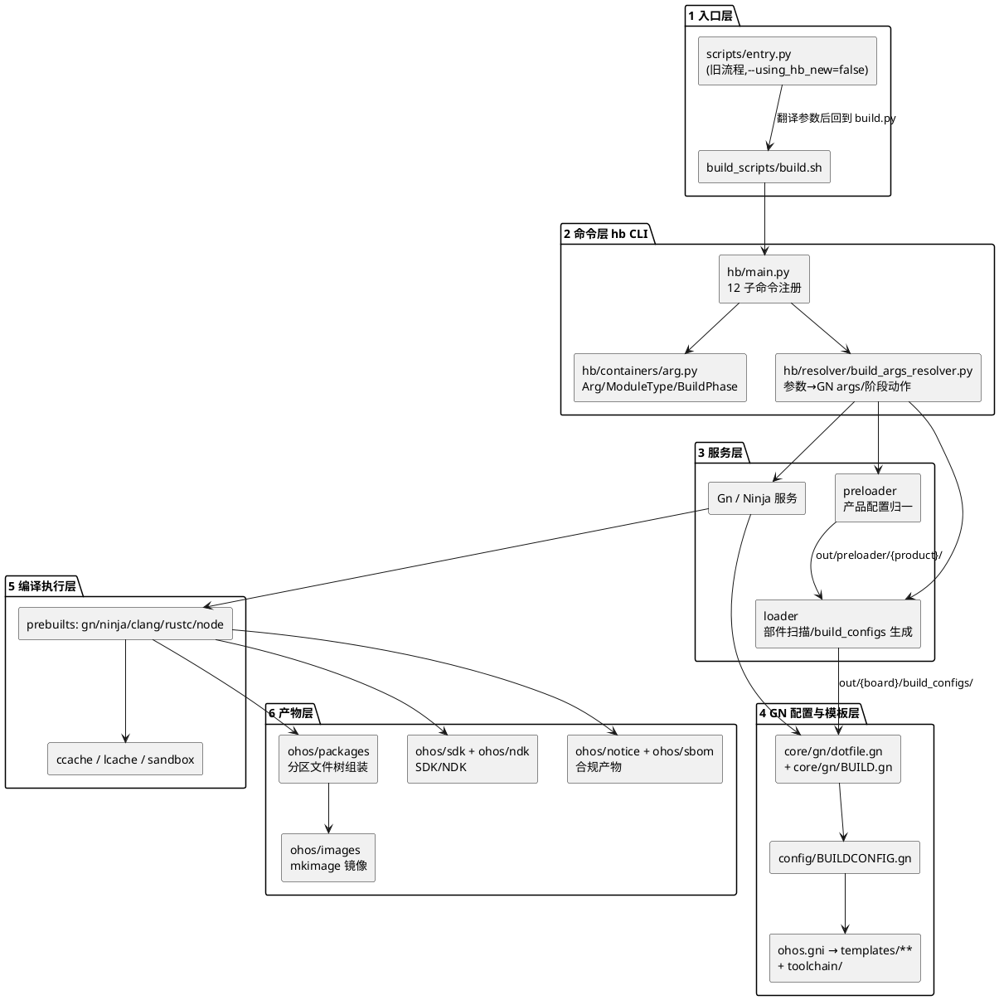

# 架构设计及约束

> 路径约定：源码路径均相对 build 仓根目录。构建在**源码树根目录**（`build/` 的父目录）执行，源码根通过向上查找 `.gn`（软链到 `core/gn/dotfile.gn`）定位。

## 架构设计

### 设计原则

| 原则 | 描述 | 理由 |
|---|---|---|
| 单一公共构建 API 面 | 业务仓统一 `import("//build/ohos.gni")` 获得全部模板；`ohos_var.gni`/`common.gni`/`version.gni` 集中声明参数 | 全 OS 数百仓消费同一构建契约；收敛 API 面使变更可审计（AGENTS.md「不可破坏」） |
| 生成器是唯一真源 | `build_configs/` 部件 GN、`*.pydeps`、`parts_info/*.json`、Notice、SBOM 均由脚本生成 | 手改生成物会被下次构建覆盖并产生 diff 噪声（AGENTS.md 明令禁止） |
| 阶段化流水线 | hb 按 prebuild+preload → load → gn(pre/target_generate) → ninja(pre/target_compilation) → post_target_compilation → post_build 的 `BuildPhase` 固定顺序编排（`hb/modules/interface/build_module_interface.py` 的 `run()`） | 参数在各阶段有明确钩子点（`hb/resolver/`），支持 `--build-only-gn`/`--fast-rebuild` 提前截断，便于调试与复用 |
| 配置三层驱动 | 产品 config.json → 部件 bundle.json → 模块 BUILD.gn 逐层收敛为部件列表、features、模块目标 | 与 OpenHarmony 产品化裁剪模型对齐；loader 只需扫描 bundle.json 即可重建目标图 |
| 可复现构建 | Node 硬锁 v14.21.1（`build_scripts/build.sh` 的 `EXPECTED_NODE_VERSION`）；ninja 环境变量按 `compile_env_allowlist.json` 过滤；版本号集中 `version.gni`；`ohos_build_time` 增量时取 `OHOS_INCREMENTAL_BUILD_TIME` 环境变量 | 相同源码+相同产品配置应产出字节级一致的结果；`ninja` 白名单为空意味着不透传宿主环境变量 |
| 产品级覆盖（products_ext） | 白名单与部分配置优先读 `out/products_ext/{product}/` 同名文件 | 产品差异不改公共配置面（`hb/util/loader/` 与 `ohos/packages/` 多处使用该模式） |
| 依赖方向单向 | 业务仓 import 本仓；本仓不反向 import 业务仓 | 本仓是公共基座，反向依赖将造成循环与全量破坏 |

### 逻辑架构

自上而下分六层（层数依据实际目录与调用关系归纳）：

**1. 入口层**：`build_scripts/build.sh`（源码根 `./build.sh` 软链；环境检查→增量工作区守卫→分发 `hb/main.py build`，`--using_hb_new=false` 走旧 `scripts/entry.py`）、`build_scripts/build.py`（`build.py` 软链，向上找 `config/BUILDCONFIG.gn` 定根）。

**2. 命令层（hb CLI）**：`hb/main.py` 的 `module_initializers` 注册 build/init/indep_build/set/env/clean/tool/install/package/publish/update/push 共 12 个子命令；`hb/containers/arg.py`（`Arg`/`ModuleType`/`BuildPhase`）从 `hb/resources/args/default/*.json` 装载参数定义；`hb/resolver/` 按阶段解析（`build_args_resolver.py` 为核心，负责产品参数注册为 GN args、build target 决策、ccache/xcache/lcache 开关、postbuild 动作）。

**3. 服务层（hb/services/ + hb/util/）**：
- `preloader.py` + `hb/util/preloader/preloader_process_data.py`：解析产品 config.json（含 v2/v3 parts 继承链），产出 `out/preloader/{product}/` 配置集；
- `loader.py` + `hb/util/loader/`：`subsystem_scan.py` 多进程扫描子系统目录下 bundle.json/ohos.build；`load_bundle_file.py` 的 `BundlePartObj.to_ohos_build()` 归一部件（含 conditions 条件编译匹配）；`load_ohos_build.py` 的 `PartObject` 为每部件×variant 生成 `build_configs/{subsystem}/{part}/BUILD.gn`；`generate_targets_gn.py` 生成 parts_list/inner_kits_list 等 gni 与 phony target；
- `gn.py`/`ninja.py`：调用 prebuilts 中的 gn（`gn gen --json=gn_log.json --args=...`）与 ninja（`-w dupbuild=warn -C out`，环境白名单过滤，日志 `out/{out}/build.log`）；
- `indep_build.py`/`hpm.py`/`prebuilts.py`/`prebuilt_sdk.py`/`hdc.py`/`menu.py`：独立编译、hpm 包管理、预下载、推包等子命令服务。

**4. GN 配置与模板层**：`core/gn/dotfile.gn`（GN 全局 dotfile：buildconfig 指向 `config/BUILDCONFIG.gn`、`exec_script_whitelist`、`ohos_components_support = true`）→ `core/gn/BUILD.gn`（顶层目标 `make_all`/`images`/`packages`/`make_inner_kits`/`make_test`）→ `config/BUILDCONFIG.gn`（产品级参数）→ `ohos.gni`（固定顺序汇总 11 组 gni，含 `support_jsapi`/`is_arkui_x` 条件分支）→ `templates/{cxx,rust,common,bpf,idl,abc,cangjie,kernel,metadata,update}/` 与 `ohos/{ace,app,ndk,notice,sa_profile,kits}/` 模板；工具链配置 `toolchain/toolchain.gni` + `toolchain/ohos/`（`ohos_clang_{arm,arm64,arm64e,x86_64,...}`）。

**5. 编译执行层**：prebuilts 的 gn/ninja/clang/rustc/node 实际执行编译；`tools/`（check_deps 依赖检查、component_tools 部件分析、lcache 增量链接缓存、module_dependence 依赖树分析）与 ccache 提供增量缓存与检查；`common/` 提供跨平台基础包（musl 安装、libcpp、asan/ubsan 运行时，common_cross_packages）；`misc/` 收录杂项（sysroot 链接路径、`misc/overrides/` 的 build.gni/gtest.gni 覆盖配置、sanitizers）；`sandbox/sandbox.sh` 为 GN action 提供输入目录隔离。

**6. 产物层**：`ohos/packages/`（`modules_install.py` 按 module_info 把产物拷入分区文件树；`parts_install_info.py` 产出已安装部件清单）→ `ohos/images/`（`build_image.py` 分区脚手架 → `mkimage/mkimages.py` 按 ext4/f2fs/cpio 分发到 `mkextimage.py`/`mkf2fsimage.py`/`mkcpioimage.py`）；`ohos/sdk/`+`ohos/ndk/`（描述 json 驱动多平台包）；`ohos/notice/`（三级 license 回退收集→hash 去重合并→`core/build_scripts/verify_notice.sh` 校验）；`ohos/sbom/`（SPDX 2.3 管线）；`ohos/sa_profile/`、`ohos/hisysevent/`、`ohos/testfwk/` 等专项产物处理。

### 非功能设计

| 场景类别 | 方案设计 |
|---|---|
| 可复现性 | Node v14.21.1 硬校验（`build_scripts/build.sh`，不匹配直接退出）；prebuilts 工具链版本由 `prebuilts_config.json`（sha256）锁定；ninja 环境变量经 `compile_env_allowlist.json` 过滤（当前 ninja 列表为空，即不透传宿主环境）；版本号集中于 `version.gni`（`sdk_version="26.1.0.23"`、`api_version="26"`、`api_full_version="26.1.0"`、`release_type="Canary1"`、`meta_version="3.0.2"`、`platform_version="26.1.0"`） |
| 增量与性能 | loader 多进程扫描（`multiprocessing.Pool`，目录深度上限 5）；`pycache_enable`（默认 true）；ccache/xcache/lcache/pycache 四级缓存开关；`--fast-rebuild` 跳过 preloader/loader；增量工作区机制（`build_scripts/incremental_workspace.py`，基线 `out/incremental_workspace.json`）；`enhanced_opt` 等优化开关 |
| 可观测性 | 日志 `out/{out}/build.log`（LogUtil 阶段标记 `[PRELOAD]/[LOAD]/[GN]/[NINJA]`），`--rename-last-log` 归档；DFX 埋点 `dfx/`（`build_tracker` 装饰器包裹 hb 各阶段，`dfx_config.json` 控制上报，输出 `out/dfx/`）；敏感信息脱敏 `sensitive_info_config.json`（`SystemUtil.SensitiveHidden` 将关键字/环境变量/正则命中项替换为 `******`） |
| 安全 | `process_field_validate.py` 高权限/关键进程白名单校验；`check_seccomp_library_name.py` seccomp 库名检查；SELinux file_contexts 参与镜像制作（`mkimage/` 各 conf，`enforce_selinux` 参数控制）；`sensitive_info_config.json` 防日志泄密 |
| 健壮性 | loader 一系列 OHOSException 校验（错误码集中 `hb/resources/status/status.json`）：缺 subsystem_config/platforms（2001-2005）、feature 未在 bundle.json 定义（2006）、部件配置不一致（2007）、syscap 命名必须 `SystemCapability.` 前缀（2008/2009）；prebuilts 下载带 sha256 校验与重试（hpm build 失败重试 3 次） |
| 环境隔离 | `sandbox/` 为 GN action 隔离输入目录；`ExecEnviron`（`hb/util/system_util.py`）按白名单构造子进程环境 |
| 资源清理 | 独立编译 `build_indep.sh` 用 trap 恢复 `.gn` 软链（独立编译与普通构建分别使用 `build/indep_configs/dotfile.gn` 与 `build/core/gn/dotfile.gn`）；`hb clean` 可清 out（保留 args.gn/build.log）、ccache、args |

## 架构约束

- **依赖方向不可反转**
  - **what**：业务仓 `import("//build/ohos.gni")`；本仓模板/脚本不得反向 import 业务仓代码；模板之间依赖保持 `ohos.gni` 声明的顺序（sanitizers → ndk → notice → sa_profile → ohos_var → toolchain → cxx → 条件分支 → common → prebuilt → rust → idl）。
  - **why**：本仓是全 OS 公共基座；反向依赖或顺序漂移将造成模板注册失败/循环 import，破坏全量构建。

- **公共 API 面冻结**
  - **what**：`ohos_*` 模板名、参数签名、默认行为，以及 `ohos_var.gni`/`common.gni`/`version.gni` 中已存在的 `declare_args()` 名与默认值不可改名/删除/静默变更；`version.gni` 版本号与发布流程绑定。
  - **why**：被所有仓库隐式消费；AGENTS.md「不可破坏」与「改动前必须请示」列明，改动签名即破坏全量构建。

- **生成物不可手改**
  - **what**：`out/{board}/build_configs/**`（部件 GN、parts_info）、`*.pydeps`、`NOTICE*`、`sbom/` 产物、`generate_part_info.py`/`copy_files.py` 输出均为生成文件。
  - **why**：生成器是唯一真源；手改会在下次构建被覆盖并产生 diff 噪声。

- **构建必须在源码树根执行**
  - **what**：`build.sh`/`build.py` 向上查找 `.gn`/`config/BUILDCONFIG.gn` 定位根；`hb/__main__.py` 向上查找 `build/hb/resources/global_var.py`；独立编译例外，须在含 `build/indep_configs/build_indep.sh` 的目录执行。
  - **why**：GN 以 `//` 根为坐标解析全部标签；在错误目录执行将找不到源码根或误判 out 路径。

- **out 路径规则**
  - **what**：产品 config.json 的 `build_out_path` 可覆盖；否则 host 编译 → `out/host/{product}`，standard → `out/{board}`，mini/small → `out/{board}/{product}`（`hb/resolver/set_args_resolver.py`）；`gn_root_out_dir` 必须位于 source_root_dir 内（loader 校验 2002/2003）。
  - **why**：镜像/打包脚本的相对坐标全部锚定 out 路径；越界将导致产物散落与误清理。

- **lite 系统独立打包方案**
  - **what**：mini/small 不走 `ohos/images` 的 mkimage 链路，`make_images` 对 lite 仅 deps `packer`（`ohos/packages/fs_process.py`），由 hb 阶段调用；lite 有自己的 `lite/config/BUILDCONFIG.gn` 与 toolchain。
  - **why**：lite 资源受限，产物形态（rootfs 目录 + 打包脚本）与标准系统镜像不同。
