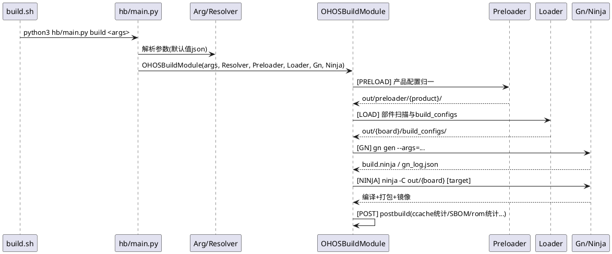

# 技术术语知识

build 仓核心技术框架和机制的知识定义，涵盖价值认知、原理、使用方式和代码关联。> 源码路径均相对 build 仓根目录。

## hb 阶段化构建流水线

### 解决的问题（Problem）
| 子维度 | 内容 |
|---|---|
| 业务痛点 | 全源码树构建链路长（产品解析→部件扫描→GN 求值→编译→打包），需要统一的编排框架支撑参数注入、阶段截断与可观测 |
| 技术目标 | 用固定阶段序 + 参数钩子解耦"命令定义/参数解析/阶段执行"，使 `--build-only-gn`、`--fast-rebuild` 等调试能力与 postbuild 扩展不侵入主流程 |

### 原理（Principles）
| 子维度 | 内容 |
|---|---|
| 核心机制 | `BuildModuleInterface.run()` 固定阶段序：prebuild+preload → load → gn(pre_target_generate/target_generate/post_target_generate) → ninja(pre_target_compilation/target_compilation) → post_target_compilation → post_build。`OHOSBuildModule`（`hb/modules/ohos_build_module.py`）每阶段 `_run_phase(phase)` 遍历所有 arg_phase 匹配的 resolver 钩子；各阶段方法带 `@build_tracker` 埋点（`dfx/`），LogUtil 打 `[PRELOAD]/[LOAD]/[GN]/[NINJA]` 标记 |
| 关键流程 | `hb/main.py` 的 `module_initializers` 按命令实例化 Module → `Arg.parse_all_args` 从 `hb/resources/args/default/*.json` 装载参数定义（当前值持久化 `out/hb_args/*.json`）→ `BuildArgsResolver` 在各阶段把参数转为动作（如 resolve_product 注册 GN args、resolve_sbom 挂 postTargetGenerate 异步线程）；失败路径：未注册命令抛 OHOSException '0018'，错误码集中 `hb/resources/status/status.json` |

### 使用方式（Usage）
| 子维度 | 内容 |
|---|---|
| 核心 API | 无独立 API；开发者入口为 CLI：`hb build --product-name X [--build-target T] [--gn-args k=v] [-f] [--ccache]`。截断开关：`--build-only-load`（跳过 GN/Ninja）、`--build-only-gn`（跳过 Ninja）、`--fast-rebuild`（跳过 preloader/loader 复用既有 build_configs） |

### 代码关联（Code）
| 子维度 | 内容 |
|---|---|
| 核心类 | `BuildModuleInterface`（`hb/modules/interface/build_module_interface.py`）、`OHOSBuildModule`（`hb/modules/ohos_build_module.py`） |
| 核心成员 | `module_initializers` 字典（`hb/main.py:114`，12 子命令）；`BuildPhase` 枚举（`hb/containers/arg.py`）；`ARGS_DIR` 参数持久化目录 |
| 核心方法 | `OHOSBuildModule.run()` 阶段序；`BuildArgsResolver.resolve_product/resolve_build_target/resolve_gn_args/resolve_ninja_args`（`hb/resolver/build_args_resolver.py`，1159 行） |

### 约束与限制（Constraints）
| 子维度 | 内容 |
|---|---|
| 系统限制 | 必须在源码树根执行（`hb/__main__.py` 向上找 `build/hb/resources/global_var.py`）；独立编译须在含 `build/indep_configs/build_indep.sh` 的目录；`-i` 必须紧跟部件名 |
| 并发约束 | 流水线整体串行；SBOM 在 postTargetGenerate 阶段以独立线程异步执行；`--fast-rebuild` 依赖上次 build_configs 存在且有效 |
| 安全约束 | ninja 子进程环境经 `ExecEnviron` 按 `compile_env_allowlist.json` 过滤（当前 ninja 列表为空=不透传宿主变量）；日志敏感项由 `sensitive_info_config.json` 脱敏兜底 |

## Preloader：产品配置归一

### 解决的问题（Problem）
| 子维度 | 内容 |
|---|---|
| 业务痛点 | 产品配置存在 v2/v3 版式差异、继承链（product_enable_list/component_exclude_list）、产品/设备专属部件等复杂来源，下游需要一份归一后的确定性配置 |
| 技术目标 | 把分散的产品定义收敛为 `out/preloader/{product}/` 下的标准配置集，隔离产品版式差异 |

### 原理（Principles）
| 子维度 | 内容 |
|---|---|
| 核心机制 | `Product._do_parse()` 依次执行 `_update_syscap_info/_update_device/_update_parts/_update_build_vars/_remove_excluded_components`；parts 继承：version 2.0 读 `parts` 字段，v3 走 `parse_vendor_product_config.py`（get_vendor_parts_list）+ 产品/设备专属部件（`product_{name}`、`device_{board}`）；`_update_build_vars` 派生 os_level/device_name/product_company/compile_mode/product_toolchain_label（`//build/toolchain/{os}:{os}_clang_{cpu}`） |
| 关键流程 | `hb set` 或 build 内联 set 写 `out/ohos_config.json` → Preloader 读产品 json → 产出：build.prop、build_config.json、parts.json、parts_config.json、build_gnargs.prop（部件 features→gn args 键值）、features.json、syscap.json、exclusion_modules.json、dependency_pruning.json、platforms.build（v2：target_os/target_cpu/toolchain/parts_config）、subsystem_config.json（合并产品/设备专属子系统）、SystemCapability.json、白名单拷贝（compile_standard/compile_env_allowlist/hvigor，优先取 `out/products_ext/{product}/` 覆盖版） |

### 使用方式（Usage）
| 子维度 | 内容 |
|---|---|
| 核心 API | 无独立 API；由 build 流水线内部触发（`hb/services/preloader.py` 的 PreloadInterface.run()）。产物目录 `out/preloader/{product}/` 可人工检视调试 |

### 代码关联（Code）
| 子维度 | 内容 |
|---|---|
| 核心类 | `Product`（`hb/util/preloader/preloader_process_data.py`）、`Dirs`（同文件，路径常量） |
| 核心成员 | `_config_file`（产品 config.json 路径）、条件上下文（compile_mode/target_os/target_cpu/os_level） |
| 核心方法 | `Product._do_parse()`；`get_vendor_parts_list`（`hb/util/preloader/parse_vendor_product_config.py`）；mini/small 分支 `parse_lite_subsystems_config.py` |

### 约束与限制（Constraints）
| 子维度 | 内容 |
|---|---|
| 系统限制 | 依赖 `out/ohos_config.json` 已 set 产品；产品 json 版式决定继承链分支 |
| 并发约束 | 单进程执行；产物目录以产品名隔离，多产品互不干扰 |
| 安全约束 | 白名单产品级覆盖只能放 `out/products_ext/{product}/`，不得改 `build/` 默认文件（合规约束） |

## Loader：多进程部件扫描与 build_configs 生成

### 解决的问题（Problem）
| 子维度 | 内容 |
|---|---|
| 业务痛点 | 全源码树有数百个仓、每个仓一个 bundle.json，逐个串行解析耗时且规则复杂（条件编译、覆盖、裁剪、平台变体） |
| 技术目标 | 快速、确定性地把源码树部件声明转换为可构建的 GN 目标图与 parts_info 数据 |

### 原理（Principles）
| 子维度 | 内容 |
|---|---|
| 核心机制 | ① `subsystem_scan.scan`：按子系统注册表 `multiprocessing.Pool` 并行 `os.walk`（max_depth=5，忽略 .git/docs/node_modules）收集 bundle.json/ohos.build；② `_override_components`：vendor/device 部件 `component.override`（subsystem:part）整部件替换并回写 parts.json；③ `platforms_loader.get_platforms_info`：读 platforms.build（v2）按 `{os}_{cpu}` 取平台配置，产出 variant→toolchain 映射；④ `load_ohos_build.get_parts_info`：`BundlePartObj.to_ohos_build()` 按 conditions 上下文匹配（compile_mode/target_os/target_cpu/os_level）+ exclusion/dependency_pruning 剪枝 + 白名单归一；⑤ `PartObject` 生成 `build_configs/{subsystem}/{part}/BUILD.gn`（模板 ohos_part/ohos_inner_kits/ohos_system_kits/ohos_part_test）；⑥ `generate_targets_gn` 生成 parts_list.gni/inner_kits_list.gni/system_kits_list.gni/parts_test_list.gni 与 phony_target、{platform}-stub |
| 关键流程 | 失败/校验：`_check_args`（2001-2005）、`_check_parts_config_info`（2007）、`_check_product_part_feature`（2006）、syscap 校验（2008/2009）；`_generate_syscap_files` 产 `out/preloader/{product}/system/etc/{SystemCapability.json,syscap.json,param/syscap.para}`；`_cropping_components` 按 parts_src_flag + third_party_allow_list + auto_install_whitelist 裁剪 components.json 后 `_merge_components_info` 合并 `out/products_ext/components.json` |

### 使用方式（Usage）
| 子维度 | 内容 |
|---|---|
| 核心 API | 内部机制；`--build-target out/{device}/build_configs/{subsystem}/{part}:{part}` 即消费其产物；`--fast-rebuild` 直接复用产物跳过本阶段 |

### 代码关联（Code）
| 子维度 | 内容 |
|---|---|
| 核心类 | `OHOSLoader`（`hb/services/loader.py`）、`BundlePartObj`（`hb/util/loader/load_bundle_file.py:29`）、`PartObject`（`hb/util/loader/load_ohos_build.py:108`） |
| 核心成员 | parts_info 落盘族：parts_info.json、part_subsystem.json、subsystem_parts.json、parts_modules_info.json、inner_kits_info.json、parts_variants.json、components.json、component_override_map.json 等（`build_configs/parts_info/`） |
| 核心方法 | `subsystem_scan.scan`；`BundlePartObj.to_ohos_build()`（`load_bundle_file.py:199`）；`generate_targets_gn.gen_targets_gn/gen_phony_targets/gen_stub_targets`；`_override_components` |

### 约束与限制（Constraints）
| 子维度 | 内容 |
|---|---|
| 系统限制 | `gn_root_out_dir` 必须位于 source_root_dir 内（2002/2003）；扫描深度上限 5 层，超出层级的 bundle.json 不会被发现 |
| 并发约束 | 扫描多进程只读；生成阶段单进程写 build_configs；`preserve_target_order` 保证生成目标顺序稳定（避免无关 diff） |
| 安全约束 | 部件/子系统一致性、feature 定义、syscap 命名（必须 `SystemCapability.` 前缀）、third_party 路径前缀等校验失败即抛 OHOSException 中止 |

## external_deps 跨部件依赖解析

### 解决的问题（Problem）
| 子维度 | 内容 |
|---|---|
| 业务痛点 | 部件间直接用 GN label 依赖会绕过部件接口契约，导致隐式耦合与 ABI 不可控 |
| 技术目标 | 用 `"部件名:模块名"` 语义把跨部件依赖约束到 inner_kits 声明的接口面，并兼容部件替换与二进制依赖 |

### 原理（Principles）
| 子维度 | 内容 |
|---|---|
| 核心机制 | `templates/common/external_deps_handler.py`：读 `build_configs/parts_info/inner_kits_info.json` + components.json + parts_variants.json + platforms_info/toolchain_to_variant.json；按 `:` 拆分 part/module；支持 component_override_map 部件替换与 `ohos/inner_kits_adapter.json` 兼容映射；按 variant（phone 用平台工具链，否则 current_toolchain）拼 `label(toolchain)` 加入 deps；so 类型补 header_base 到 include_dirs；prebuilt_enable 时补 prebuilt_source 到 libs；use_sdk 时改从 sdk_info.json 解析为 `//{sdk_dir}/{part}:{module}` |
| 关键流程 | GN 求值模块模板 → external_deps 属性 → exec_script 调 external_deps_handler.py → 返回 temp json（deps/libs/include_dirs）注入目标；定制 GN 的 `ohos_components_support = true`（dotfile.gn）使 external_deps 成为原生目标属性；`ohos_skip_parse_external_deps`（ohos_var.gni）为逃生口 |

### 使用方式（Usage）
| 子维度 | 内容 |
|---|---|
| 核心 API | BUILD.gn 内：`external_deps = [ "部件名:模块名" ]`；被依赖模块必须在对方 bundle.json `inner_kits` 中声明；部件内依赖仍用 `deps`（裸 label）。详见 `docs/关于deps及external_deps的使用.md` |

### 代码关联（Code）
| 子维度 | 内容 |
|---|---|
| 核心类 | `external_deps_handler.py`（`templates/common/`） |
| 核心成员 | 输入：inner_kits_info.json、component_override_map、inner_kits_adapter.json；输出：deps/libs/include_dirs |
| 核心方法 | 主解析函数（读 json→拆分→variant 拼 label→写 temp json）；检查链路 `check_target`（`templates/common/check_target.gni` → check_build_target.py，对照 compile_standard_whitelist.json，is_use_check_deps 默认开） |

### 约束与限制（Constraints）
| 子维度 | 内容 |
|---|---|
| 系统限制 | 依赖 loader 先生成 inner_kits_info.json（--fast-rebuild 时复用旧产物）；exec_script 受 dotfile.gn 的 exec_script_whitelist 限制 |
| 并发约束 | 每模块独立 exec_script，GN 调度并行；无共享写 |
| 安全约束 | 绕过 external_deps 用裸 label 跨部件依赖会被 `__check` 目标拦截（白名单豁免除外） |

## ohos.gni 模板汇总与 ohos_* 模板体系

### 解决的问题（Problem）
| 子维度 | 内容 |
|---|---|
| 业务痛点 | 全 OS 数百仓需要一致的构建语义（安装、notice、module_info、sanitize、版本脚本、测试），逐仓自定义不可维护 |
| 技术目标 | 提供统一模板层：业务仓一行 `import("//build/ohos.gni")` 获得全部能力，模块声明即可获得安装/合规/元数据全套行为 |

### 原理（Principles）
| 子维度 | 内容 |
|---|---|
| 核心机制 | `ohos.gni` 固定顺序汇总 11 组 gni：sanitizers → ndk → notice → sa_profile → ohos_var → toolchain → cxx →（`support_jsapi` 条件：ace/app）→ common(ohos_templates) → prebuilt →（`is_arkui_x` 分支：build_plugins java / `!is_host_product` 的 bpf + rust 四件套）→ idl。模板自动挂子目标：`__notice`（collect_notice）、`__collect`、`__check`、`_info`（generate_module_info）。`gen_install_dests()` 按 install_images 映射 base_dir 拼 dest；innerapi_tags（ndk/llndk/chipsetsdk/platformsdk/passthrough/sasdk）自动设安装目录并互斥断言；shlib_type 自动注入 version_script（sa→singleton、hdi→hdi、ani→ani、napi 判定→napi.versionscript） |
| 关键流程 | 业务仓 BUILD.gn 声明 `ohos_shared_library("x")` → GN 展开模板 → 生成编译目标 + notice 收集 + module_info 元数据 + 安装信息聚合（metadata.install_modules → generated_file *_install_info） |

### 使用方式（Usage）
| 子维度 | 内容 |
|---|---|
| 核心 API | `import("//build/ohos.gni")` 后使用：cxx 族（ohos_executable/shared_library/static_library/source_set/shared_headers/prebuilt_*）、rust 族（ohos_rust_library/ohos_cargo_crate/rust_bindgen/rust_cxx 等）、bpf/idl/abc/cangjie/kernel/metadata/update 族、ohos/ 下 hap/ndk/notice/sa_profile 族；测试模板单独 `import("//build/test.gni")`（ohos_unittest/moduletest/systemtest/performancetest/securitytest/reliabilitytest/distributedtest/fuzztest/benchmarktest + python/js/arkts/rust 全套，_ohos_test 强制 subsystem_name="tests"、输出 `$root_out_dir/tests/{test_type}/`） |

### 代码关联（Code）
| 子维度 | 内容 |
|---|---|
| 核心类 | `templates/{cxx,rust,common,bpf,idl,abc,cangjie,kernel,metadata,update}/` 各 gni；`ohos/{ace,app,ndk,notice,sa_profile,kits}/` |
| 核心成员 | `ohos.gni`（44 行固定顺序）；`ohos_var.gni` 目录基址组（system_base_dir="system" 等）；`toolchain/toolchain.gni`（clang_version="15.0.4"、后缀规则：is_ohos 且 component_build 时 `.z.so`） |
| 核心方法 | `gen_install_dests()`（`templates/metadata/gen_module_info.py:62`）；`generate_module_info`（module_info.gni）；`external_deps_handler.py`（见 [external_deps 跨部件依赖解析](#external-deps-跨部件依赖解析) 机制节） |

### 约束与限制（Constraints）
| 子维度 | 内容 |
|---|---|
| 系统限制 | 模板禁自定义 output_dir；test.gni 不在 ohos.gni 内（测试模块单独 import）；cangjie/kernel/metadata/update 等特殊模板按需才进依赖图 |
| 并发约束 | exec_script（module_info、external_deps）在 GN 阶段并行调度；`.pydeps` 声明脚本输入支撑正确增量 |
| 安全约束 | sanitize 体系（ohos_sanitizer_config）强校验，`allow_sanitize_debug`（build_xtx=true）才跳过；模板签名/名称/默认值冻结（公共 API） |

## 模块安装与镜像制作链路

### 解决的问题（Problem）
| 子维度 | 内容 |
|---|---|
| 业务痛点 | 数千模块产物需要按分区、按路径规则组装成可烧录镜像，且需配套 DAC/SELinux/权限校验 |
| 技术目标 | 从 module_info 到分区文件树到镜像的全自动确定性管线 |

### 原理（Principles）
| 子维度 | 内容 |
|---|---|
| 核心机制 | ① `{platform}_parts_list`（parts_install_info.py 读 target_platforms_parts.json + all_parts_info.json 产 system_install_parts.json，含每部件 part_info_file）+ kernel_permission.py；② 并行支线：sa_profile_install_info（merged_sa_profile.zip）、hisysevent_install_info、stage_notice/merge/verify、generate_host_symlink；③ `{platform}_install_modules`（modules_install.py：逐部件→逐模块读 module_info，跳过 install_enable=false，按 dest 拷入 `packages/{platform}/{分区}`，处理 symlink 族，hap/hsp 目录整拷，提取 merged_sa_profile 进 system，产出 system_install_modules.json/system_module_info.json/system_modules_list.txt/system.zip）；④ process_field_validate + check_seccomp；⑤ `{platform}_{image}_image`（build_image.py 分区脚手架 → mkimages 按 fs_type 分发 mkext/mkf2fs/mkcpio） |
| 关键流程 | root 分区 bin/etc/lib 软链到 /system/...；userdata 先清空重建；eng_system 按 root_image.json 拷 ohos.para/hdcd.cfg/policy.31/init（build_variant=user 时置空）；设备 imagesconf 覆盖仓内默认 conf；arm64e 模块按 `system_arm64e_whitelist.json` 分流 |

### 使用方式（Usage）
| 子维度 | 内容 |
|---|---|
| 核心 API | ninja 目标：`images`（默认，全镜像）、`packages`（只组包不出镜像）、`make_all`（inner_kits+packages+images）、`package_testcase`（测试包）。产物：`out/{device}/packages/phone/images/` |

### 代码关联（Code）
| 子维度 | 内容 |
|---|---|
| 核心类 | `ohos/packages/BUILD.gn`（make_packages 编排）、`ohos/images/BUILD.gn`（make_images 编排）、`Packer`（`ohos/packages/fs_process.py`，lite 用） |
| 核心成员 | `mkimage/{image}_image_conf.txt`（挂载点/大小/flags）、`mkimage/dac.txt`（mode-uid-gid-cap）、`categorized-libraries.json`（分类库标签） |
| 核心方法 | `copy_modules()`（`ohos/packages/modules_install.py:68`）、`_get_modules_info()`（:33）；`_prepare_root()`（`ohos/images/build_image.py:36`）、`_prepare_ramdisk()`（:81）、`_make_image()`（:127）；`mkimages.load_config` |

### 约束与限制（Constraints）
| 子维度 | 内容 |
|---|---|
| 系统限制 | 镜像 action 前置 install_modules（强依赖序）；e2fsprogs/f2fs-tools host 工具必须就位（action deps）；lite 系统不走本链路（fs_process.py packer 由 hb 调用） |
| 并发约束 | 各镜像 action 互相独立可并行；模块拷贝按部件分区串行化避免竞争 |
| 安全约束 | DAC 与 SELinux file_contexts 配套强制；高权限/关键进程白名单校验（process_field_validate.py）失败即中止 |

## Notice 收集-合并-校验

### 解决的问题（Problem）
| 子维度 | 内容 |
|---|---|
| 业务痛点 | 镜像内每个开源组件都需许可声明，手工维护不可行且易漏 |
| 技术目标 | 从模块声明自动收集 license，去重合并为系统级 NOTICE 族并强制校验 |

### 原理（Principles）
| 子维度 | 内容 |
|---|---|
| 核心机制 | 模块级：每模板自动挂 `collect_notice` action（notice.gni），license 三级回退（license_file 参数 → 模块目录 README.OpenSource 的 License File/Name/Version Number 字段 → 沿目录向上递归找 LICENSE/NOTICE/COPYRIGHT/COPYING 到 .gn 根），同时收集伴生 COPYRIGHT/COPYING，输出 `.notice.txt` + `.notice.txt.json`（Software/Version/Path）；系统级：collect_notice_files 按 part→module 链拷贝打 zip（system_notice_files.zip）→ merge_notice_files 按内容 hash 去重合并为 NOTICE.txt + NOTICE.xml.gz + NOTICE_module_info.json → `core/build_scripts/verify_notice.sh` 分区行数一致性校验 |
| 关键流程 | static_library/source_set/rust_library 的 notice 落 `NOTICE_FILES/static/{toolchain}/{subsystem}/{part}/*.a.txt`；SDK 模块按 install_dir 落 `NOTICE_FILES/sdk`；NDK/SDK 各有 merge_ndk_notice/generate_sdk_notice |

### 使用方式（Usage）
| 子维度 | 内容 |
|---|---|
| 核心 API | 模块侧：`license_file` 参数指定 license（推荐显式声明）；全局开关 `enable_notice_collection`（ohos_var.gni，默认 true）。收集策略见 `docs/开源软件Notice收集策略说明.md` |

### 代码关联（Code）
| 子维度 | 内容 |
|---|---|
| 核心类 | `collect_notice` 模板（`ohos/notice/notice.gni`） |
| 核心成员 | `.notice.txt.json` 结构（Software/Version/Path） |
| 核心方法 | `do_collect_notice_files()`/`get_license_from_readme()`/`find_license()`/`find_opensource()`（`ohos/notice/collect_module_notice_file.py`）；`do_merge_notice_files()`/`compute_hash()`（`ohos/notice/merge_notice_files.py`）；`verify_notice.sh`（`core/build_scripts/`） |

### 约束与限制（Constraints）
| 子维度 | 内容 |
|---|---|
| 系统限制 | 三级回退全部未命中则该模块 notice 缺失（verify 阶段暴露）；NOTICE.txt 与 NOTICE.xml.gz 同源 |
| 并发约束 | 模块级收集随 ninja 并行；合并/校验在打包阶段串行 |
| 安全约束 | 合规闭环不变量：三方依赖变更必须同步 Notice 与 OAT（`OAT.xml` 为独立静态审计配置）；生成文件禁手改 |

## SBOM 生成（SPDX 2.3）

### 解决的问题（Problem）
| 子维度 | 内容 |
|---|---|
| 业务痛点 | 发布物需要标准化软件物料清单（组件、版权、依赖关系）满足合规审计 |
| 技术目标 | 从构建产物与源码 manifest 自动产出 SPDX 2.3 格式 SBOM |

### 原理（Principles）
| 子维度 | 内容 |
|---|---|
| 核心机制 | `--sbom` 触发（`resolve_sbom` 在 postTargetGenerate 阶段异步线程执行；build.sh 侧注入 `--gn-flags=--json-file-name=sbom/gn_gen.json`）→ generate_sbom.py：`generate_manifest()` 先跑 `python .repo/repo/repo manifest -r -o` 生成 manifest_tag_*.xml；`generate_sbom()` 由 SBOMGenerator.build_sbom 组装：InstallModuleAnalyzer + DependGraphAnalyzer → 文件/包/文档信息（extraction/ 从 gn_gen.json 与 manifest 加载，analysis/ 做安装模块/依赖图/文件依赖/项目依赖分析，copyright_and_license_scanner 扫版权）→ converters/spdx23.py 转换输出 |
| 关键流程 | 输出 `{out}/sbom/sbom_meta_data.json` + `spdx.json`；完成后清理临时 manifests 与 gn_gen.json |

### 使用方式（Usage）
| 子维度 | 内容 |
|---|---|
| 核心 API | `./build.sh --product-name X --sbom`（或 `hb build --sbom`）；无独立运行入口 |

### 代码关联（Code）
| 子维度 | 内容 |
|---|---|
| 核心类 | `SBOMGenerator`（`ohos/sbom/pipeline/sbom_generator.py`）、`SBOMConverter`（`ohos/sbom/converters/spdx23.py`）、data/ 模型（manifest/ninja_json/target） |
| 核心成员 | 输入：`out/sbom/gn_gen.json`、repo manifest；输出：sbom_meta_data.json、spdx.json |
| 核心方法 | `generate_manifest()`（`ohos/sbom/generate_sbom.py:38`）、`generate_sbom()`（:92）、`SBOMGenerator.build_sbom` |

### 约束与限制（Constraints）
| 子维度 | 内容 |
|---|---|
| 系统限制 | 依赖 .repo/repo 存在（repo manifest）；依赖 gn gen 的 json 输出；异步执行不阻塞主构建 |
| 并发约束 | 独立线程执行；与 ninja 打包共享 out 目录但只写 sbom/ 子目录 |
| 安全约束 | 产物禁止手工编辑或伪造（生成物不可变约束）；`resolve_sbom` 在 resolver 层收口，不得旁路触发 |

## 预编译工具链下载引擎（prebuilts_service）

### 解决的问题（Problem）
| 子维度 | 内容 |
|---|---|
| 业务痛点 | 构建依赖 29 类宿主工具，手工下载/校验/布置易错且慢；独立编译只需子集 |
| 技术目标 | 声明式配置 + 并发下载 + 后处理自动化，支撑全量与独立编译两种规模 |

### 原理（Principles）
| 子维度 | 内容 |
|---|---|
| 核心机制 | `prebuilts_config.py` 解析 `prebuilts_config.json`：ConfigParser 含 tag/build_type/build_level 过滤、平台/CPU 匹配、配置继承（平台>工具>全局）、`${var}` 变量解析 → 相同 remote_url 合并下载项 → PoolDownloader 线程池并发下载（download_util 带 sha256 内存缓存与锁）→ OperateHanlder 执行后处理（symlink/copy/remove/move/shell 五类 handle） |
| 关键流程 | 全量：prebuilts_download.sh（建 oh_venv + pip 装依赖 → prebuilts_config.py → L0/L1 精简 vs 标准集 pip 包 → 可选 --download-sdk → 整理 llvm libcxx-ndk/合成 llvm_ndk）；独立编译：prebuilts_config.sh（--download-sdk，build-type=indep，落盘 `~/.prebuilts_cache`，按 part_prebuilts_config.json 部件→tag 裁剪，恒加 "base"）；hb indep 前 `services/prebuilts.py` 按 `prebuilts/.local_data/last_update.json` + 配置 mtime 判断跳过（--skip-prebuilts 逃逸） |

### 使用方式（Usage）
| 子维度 | 内容 |
|---|---|
| 核心 API | `bash build/prebuilts_download.sh`（全量）；`bash build/prebuilts_config.sh [--download-sdk]`（独立编译预下载）；新增工具改 `prebuilts_config.json`（配置指南 `prebuilts_service/README_zh.md`） |

### 代码关联（Code）
| 子维度 | 内容 |
|---|---|
| 核心类 | `ConfigParser`（`prebuilts_service/config_parser.py:23`）、`PoolDownloader`（`prebuilts_service/pool_downloader.py:36`）、`OperateHanlder`（`prebuilts_service/operater.py:39`） |
| 核心成员 | `prebuilts_config.json`（download_root + 29 项 tool_list）；`part_prebuilts_config.{py,json}`（部件→tag 映射） |
| 核心方法 | 下载主流程（prebuilts_config.py）；`download_util`（sha256 缓存） |

### 约束与限制（Constraints）
| 子维度 | 内容 |
|---|---|
| 系统限制 | 全量下载落 `../openharmony_prebuilts`（源码树旁）、indep 落 `~/.prebuilts_cache`；Node 硬锁 v14.21.1；`prebuilts_download.py`（旧版独立实现）仅 `--build-arkuix` 分支使用 |
| 并发约束 | 线程池并发下载；sha256 内存缓存与锁防重复；hpm build 失败自动重试 3 次 |
| 安全约束 | remote_url+sha256 强校验；npm/ohpm 源固定（华为云/harmonyos），不得随意替换 |

## 独立编译（indep）

### 解决的问题（Problem）
| 子维度 | 内容 |
|---|---|
| 业务痛点 | 修改单个部件也要全量源码树 + 全量 prebuilts，门槛高、耗时长 |
| 技术目标 | 只需 build 仓 + 目标部件仓，其余依赖以二进制包下载（`~/.hpm`），实现单部件快速编译 |

### 原理（Principles）
| 子维度 | 内容 |
|---|---|
| 核心机制 | ① 触发：`hb build {comp} -i`；`judge_indep_args_resolver.ArgsResolver.is_indep_args()` 判定产品在 `indep_component_whitelist.json` 且部件在清单内才自动转换（`--no-indep` 逃逸）；② 依赖获取：按 bundle.json `component.deps` 从 repo.harmonyos.com 下载二进制包到 `~/.hpm`（或 `--local-binarys` 本地目录，生成 dependences.json 并软链子目录到 binarys/）；③ 编排：`services/indep_build.py` 调 `/bin/bash build/indep_configs/build_indep.sh`；④ 脚本：trap 恢复 `.gn` 软链（独立编译临时用 `build/indep_configs/dotfile.gn`）→ generate_components.py（按 dependences.json 拼 bundle 路径、软链源码到 out）→ generate_target_build_gn.py → variants_info_handler.py → gn_ninja_cmd.py（--fast-rebuild 走捷径分支）；并从 binarys 补齐 third_party/rust/crates、test/testfwk/developer_test、typescript 等必备仓 |
| 关键流程 | test 参数 0/1/2 映射 OUT_DIR=src/src_test/test；`--product-name` 时把 out 拷贝为产品名目录；config/ 下 download_part_whitelist.json（部件→额外必下载 tag）、binary_package_exclusion_list.json（googletest/benchmark 等排除）控制下载集 |

### 使用方式（Usage）
| 子维度 | 内容 |
|---|---|
| 核心 API | 在含 `build/indep_configs/build_indep.sh` 的目录执行 `hb build {component} -i`（`-i` 必须紧跟部件名）；预下载 `bash build/prebuilts_config.sh --download-sdk`。详见 `indep_configs/README_zh.md` 与 `docs/部件独立编译使用指南.md` |

### 代码关联（Code）
| 子维度 | 内容 |
|---|---|
| 核心类 | `ArgsResolver`（`hb/resolver/judge_indep_args_resolver.py`）、`IndepBuild`/`Hpm`/`PreuiltsService`（`hb/services/`） |
| 核心成员 | `indep_component_whitelist.json`（产品 rk3568 + 部件清单 + unsupport-args）；`indep_configs/config/` 三配置 |
| 核心方法 | `ArgsResolver.is_indep_args`/`get_retain_args`；`build_indep.sh` 主流程；`_init_indep_build_module`（`hb/main.py`，目录硬检查） |

### 约束与限制（Constraints）
| 子维度 | 内容 |
|---|---|
| 系统限制 | Ubuntu 22.04+；必须在含 build_indep.sh 的目录执行（main.py 硬检查 `you are running hb build command in wrong dir!`）；仅白名单产品/部件可用 |
| 并发约束 | `.gn` 软链切换期间非线程安全（trap 保证恢复）；hpm 下载有版本检查线程（仅提示） |
| 安全约束 | 二进制依赖来源固定 repo.harmonyos.com；external_deps 解析为二进制依赖，不得混入源码仓路径 |

## 可观测性与脱敏（dfx / build_tracker / 日志）

### 解决的问题（Problem）
| 子维度 | 内容 |
|---|---|
| 业务痛点 | 构建失败定位难、构建行为无法度量、日志可能泄漏敏感信息 |
| 技术目标 | 阶段埋点可度量、日志可追溯、敏感信息强制脱敏、子进程环境可控 |

### 原理（Principles）
| 子维度 | 内容 |
|---|---|
| 核心机制 | ① `dfx/` 的 `build_tracker` 装饰器包裹 hb 各阶段方法，按 `dfx_config.json`（build_dfx_enable、上报 API、加密 header）输出 trace 到 `out/dfx/`；prebuilts_config.py 与 hb 各阶段均接入。② 日志：`out/{out}/build.log`，`--rename-last-log` 归档 `build.{mtime}.log`；gn_log.json/gn_trace.log/ccache 日志同目录。③ 脱敏：`sensitive_info_config.json`（keywords/env_vars/regex_patterns）+ `SystemUtil.SensitiveHidden` 在打日志时替换为 `******`。④ 环境控制：`ExecEnviron`（`hb/util/system_util.py`）按 `compile_env_allowlist.json` 构造子进程环境（产品可在 out/products_ext 覆盖） |
| 关键流程 | LogUtil 阶段标记 [PRELOAD]/[LOAD]/[GN]/[NINJA]；构建时长由 main.py 汇报 Cost Time |

### 使用方式（Usage）
| 子维度 | 内容 |
|---|---|
| 核心 API | `--log-level {debug,info,error}`；`--rename-last-log`；postbuild 分析：`--stat-ccache/--stat-lcache/--get-warning-list/--generate-ninja-trace/--rom-size-statistics`（性能工具见 `docs/编译性能分析工具使用.md`） |

### 代码关联（Code）
| 子维度 | 内容 |
|---|---|
| 核心类 | `build_tracker` 装饰器（`dfx/`）、`LogUtil`、`SystemUtil.ExecEnviron`（`hb/util/system_util.py`） |
| 核心成员 | `dfx/dfx_config.json`、`sensitive_info_config.json`、`compile_env_allowlist.json` |
| 核心方法 | `SystemUtil.get_current_time`（计时）；`SensitiveHidden`（脱敏替换） |

### 约束与限制（Constraints）
| 子维度 | 内容 |
|---|---|
| 系统限制 | ninja 环境白名单当前为空列表（不透传宿主环境变量，保可复现）；dfx 上报受 dfx_config.json 开关控制 |
| 并发约束 | 多阶段埋点串行追加 trace；日志文件单写者 |
| 安全约束 | 脱敏是兜底不是依赖——代码中不得主动明文打印密钥/token；`sensitive_info_config.json` 改动属敏感配置变更 |

## 构建框架自测试（test/）

### 解决的问题（Problem）
| 子维度 | 内容 |
|---|---|
| 业务痛点 | 模板/参数改动影响全 OS，需要构建级别的回归能力（不是单元测试能覆盖的） |
| 技术目标 | 用真实构建验证构建选项、模板产物与构建性能 |

### 原理（Principles）
| 子维度 | 内容 |
|---|---|
| 核心机制 | `script/start_env.sh` 装 pytest/pytest-html/pytest-metadata/py；`script/start_ex.sh {option|template|performance|all}`：先 `rm -rf out`、把 `test/example/test_build.json` 覆盖到 `build/common/bundle.json`（让 build 仓自身部件指向用例源）→ option 用 wifiiot_hispark_pegasus 跑 ~30 个构建参数用例（`test/example/test_build_option.py`，1139 行，parametrize 多取值，跑前 `repo forall git reset/clean`）→ template 用 rk3568 构建后校验 `test_example_template/` 下 20 个模板用例（cangjie 宏/共享/静态库、executable、prebuilt×4、sa_profile、shared_headers、source_set 等）的产物 → performance 对 rk3568/wifiiot 各跑一条 `--gn-flags=--time` 命令，分析 gn/ninja trace、ccache 命中与 C targets overlap rate，自绘 HTML 报告 |
| 关键流程 | 报告输出 `out/test_report/`；配置 `test/example/build_example.json`（三类各自的命令/超时/报告路径）；`all` 顺序固定 option→performance→template；另有 `test/incremental/`（unittest 增量构建回归：重定位、并发工作区、产物丢失、ramdisk 字节，要求 Py3.10+/bubblewrap/真实 prebuilts） |

### 使用方式（Usage）
| 子维度 | 内容 |
|---|---|
| 核心 API | `bash build/test/script/start_env.sh`（一次性）；`bash build/test/script/start_ex.sh {option|template|performance|all}`；增量回归 `python3 -m unittest discover -s build/test/incremental` |

### 代码关联（Code）
| 子维度 | 内容 |
|---|---|
| 核心类 | `TestBuildOption`（`test/example/test_build_option.py`） |
| 核心成员 | `test/example/build_example.json`（用例配置）；`test/example/test_example_template/`（模板样例） |
| 核心方法 | `start_ex.sh` 编排；`performance_test.py` 分析 |

### 约束与限制（Constraints）
| 子维度 | 内容 |
|---|---|
| 系统限制 | **破坏性**：会 `rm -rf out`、覆盖 `build/common/bundle.json`、`repo forall git reset --hard + clean -dfx`——只能在专用流水线环境跑，禁止在含未提交改动的工作区执行 |
| 并发约束 | 三类测试顺序不可变（all）；每次运行全量重建 |
| 安全约束 | 无（离线运行，无外部上报） |
