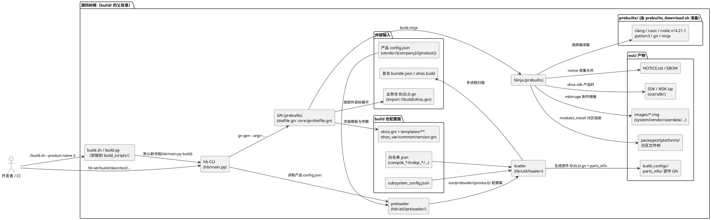

# 业务背景

> 路径约定：本文档中源码路径均相对 build 仓根目录（`@ohos/build_framework`，子系统 `build`，版本 4.0.2）。

## 应用定位

### 核心职责

OpenHarmony 编译构建子系统，提供一套基于 **GN + Ninja** 的编译构建框架，是整个 OpenHarmony 源码树的公共构建基座。核心职责：

1. **公共构建 API**：`ohos.gni` 汇总入口与 `ohos_*` 系列 GN 模板（`ohos_shared_library`、`ohos_executable`、`ohos_rust_library`、`ohos_hap` 等，位于 `templates/`），被全 OS 所有业务仓 `import("//build/ohos.gni")` 消费；构建参数集中声明在 `ohos_var.gni`、`common.gni`、`version.gni`。
2. **构建编排**：`hb` 命令行工具（`hb/`，pip 包名 `ohos-build`）按 preloader → loader → gn gen → ninja → 打包的阶段化流水线驱动一次完整构建（入口分发见 `build_scripts/build.sh`、`hb/main.py`）。
3. **产品/子系统/部件三级配置解析**：读取 `vendor/{company}/{product}/config.json`（产品）、`build/subsystem_config.json`（子系统注册表）与各仓 `bundle.json`（部件），生成 `out/{board}/build_configs/` 下的部件 GN 组织与 parts_info 数据。
4. **产物生成**：将编译产物按 `install_images` 分区收集，制作 system/vendor/userdata 等分区镜像（`ohos/packages/`、`ohos/images/`），并生成 SDK/NDK（`ohos/sdk/`、`ohos/ndk/`）、开源 Notice（`ohos/notice/`）、SBOM（`ohos/sbom/`）等合规与交付产物。
5. **工具链管理**：预编译工具链（clang/gn/ninja/node/python/rust 等）的下载与版本管理（`prebuilts_download.sh`、`prebuilts_config.py`、`prebuilts_service/`）。
6. **轻量系统支持**：mini/small 系统的构建入口与打包方案（`lite/`）。
7. **测试基础设施**：`test.gni` 测试模板（unittest/moduletest/systemtest/fuzztest/benchmarktest 等全套）与构建框架自身的 pytest 回归（`test/`）。

### 职责边界（本组件不负责）

| 不负责事项 | 承担方 | 依据 |
|---|---|---|
| 业务模块源码的编译、汇编、链接 | prebuilts 中的 clang/lld、rustc 与 ninja 调度 | `toolchain/` 仅做工具链配置封装，不实现编译器行为 |
| 产品的部件组成与特性定义 | 各产品仓 `vendor/{company}/{product}/config.json` | build 仓只读取与解析，不定义产品内容 |
| 各业务部件的构建入口声明 | 各业务仓根 `bundle.json`（`component.build.sub_component` 等） | build 仓 loader 只扫描归一 |
| 子系统名→源码路径的注册内容 | `build/subsystem_config.json`（全局共识文件） | build 仓提供机制与校验，注册项由各子系统维护 |
| 三方源码内容 | `third_party/` 各仓 | build 仓仅通过 `third_party_allow_list.json` 等做合规检查 |
| XTS 测试套件模板 | `//test/xts/tools/`（仓外） | build 仓仅提供 `test.gni` 通用测试模板与打包收集 |
| CI 流水线调度 | 独立 CI 系统 | 本仓只产出镜像/包与测试报告 |
| mini/small 系统的独立构建框架 | `build_lite` 仓（本仓 `lite/` 为 lite 侧在标准仓内的入口与配置） | README_zh.md「相关仓」 |

## 系统上下文

## 核心输入

| 输入 | 来源 | 主要内容 | 触发时机 |
|---|---|---|---|
| 构建命令行 | 开发者/CI 在源码树根执行 `./build.sh` 或 `hb build` | `--product-name`、`--build-target`、`--gn-args`、`--ninja-args`、`--build-only-gn`、`-f` 等 | 每次构建 |
| 产品配置 | `vendor/{company}/{product}/config.json`（或 `productdefine/common/products/` 内置、`out/products_ext/vendor` 扩展） | 产品名、os_level、board、kernel、target_cpu、部件列表与 features、继承链（version 2.0 `parts` / v3 vendor parts list） | `hb set` 或带 `--product-name` 的 `hb build` |
| 子系统注册表 | `build/subsystem_config.json` + 产品侧 `subsystem_config_overlay.json` | 子系统名 → 源码路径列表 | loader 扫描前 |
| 部件清单 | 全源码树各仓 `bundle.json` / 旧式 `ohos.build` | `component.build.{sub_component, inner_kits, test, conditions}`、features、syscap | loader 扫描阶段（多进程 `os.walk`，深度上限 5，忽略 .git/docs/node_modules） |
| 模块构建脚本 | 各业务仓 `BUILD.gn` | `ohos_*` 模板实例：sources、deps、external_deps、install_images、part_name 等 | `gn gen` 求值阶段 |
| GN 参数 | `ohos_var.gni`/`common.gni`/`version.gni`/`config/BUILDCONFIG.gni` 的 `declare_args` + 命令行 `--gn-args` + preloader 生成的 `build_gnargs.prop`（部件 features） | 产品名、工具链、目录基址、版本号、行为开关 | `gn gen` |
| 预编译工具链 | `prebuilts_config.json` 声明的 29 类工具（node/cmake/gn/ninja/clang/python/rust/hvigor/cangjie/hpm 等） | remote_url + sha256，按平台×CPU 匹配 | `prebuilts_download.sh` / `prebuilts_config.py`（独立编译预下载走 `prebuilts_config.sh --download-sdk`） |
| 白名单 | 仓根 `*_whitelist.json` / `*_allowlist.json`，可被 `out/products_ext/{product}/` 同名文件覆盖 | 编译规范豁免、独立编译部件、ninja 环境变量、三方部件、自动安装部件、arm64e 豁免等 | loader 校验、ninja 执行前 |
| 独立编译依赖 | repo.harmonyos.com 二进制包（下载到 `~/.hpm`）或 `--local-binarys` 本地目录 | 依 `component.deps` 解析的部件二进制 | `hb build {comp} -i` |

## 核心输出

| 输出 | 位置 | 接收方 | 业务作用 |
|---|---|---|---|
| 分区镜像 | `out/{board}/packages/phone/images/{system,vendor,userdata,ramdisk,...}.img` | 设备烧录 / 版本发布 | 可烧录的系统版本（标准系统默认 ninja 目标 `images`） |
| 分区文件树 | `out/{board}/packages/{platform}/{system,vendor,sys_prod,chip_prod,...}/` | 镜像制作中间产物、厂商包发布 | 模块按 dest 落盘的组装结果 |
| 部件构建配置 | `out/{board}/build_configs/{subsystem}/{part}/BUILD.gn`、`parts_info/*.json`、`subsystem_info/*` | GN 求值 / `--build-target` 完整形式 `out/{device}/build_configs/{subsystem}/{part}:{part}` 即源于此 | 把全源码树部件组织成可构建的 GN 目标图 |
| preloader 配置集 | `out/preloader/{product}/`（build.prop、parts.json、features.json、syscap.json、SystemCapability.json 等） | loader、设备侧 syscap | 产品配置归一结果 |
| SDK / NDK | `out/sdk/packages/ohos-sdk/{linux,windows,darwin}/` 下 `{type}-{os}-{arch}-{version}.zip` | 应用/南向开发者 | ohos-sdk 产品构建产物 |
| 开源合规产物 | `NOTICE.txt`、`NOTICE.xml.gz`、`NOTICE_module_info.json`（进 system/etc 或 vendor/etc）、`out/{board}/sbom/`（spdx.json） | 法务合规、发布流程 | 开源软件许可声明与 SBOM 清单 |
| 测试包 | `packages/{platform}/tests/{unittest,moduletest,systemtest,...}`、module_list_files(.mlf) | XTS 执行框架 | `package_testcase` 收集的测试套件 |
| 构建日志与诊断 | `out/{board}/build.log`（`--rename-last-log` 归档 `build.{mtime}.log`）、`gn_log.json`、`out/dfx/` 埋点 | 开发者 / DFX 平台 | 问题定位与构建性能分析 |
| 增量工作区基线 | `out/incremental_workspace.json` | `build_scripts/incremental_workspace.py` | 源码树搬迁/重定位检测 |
